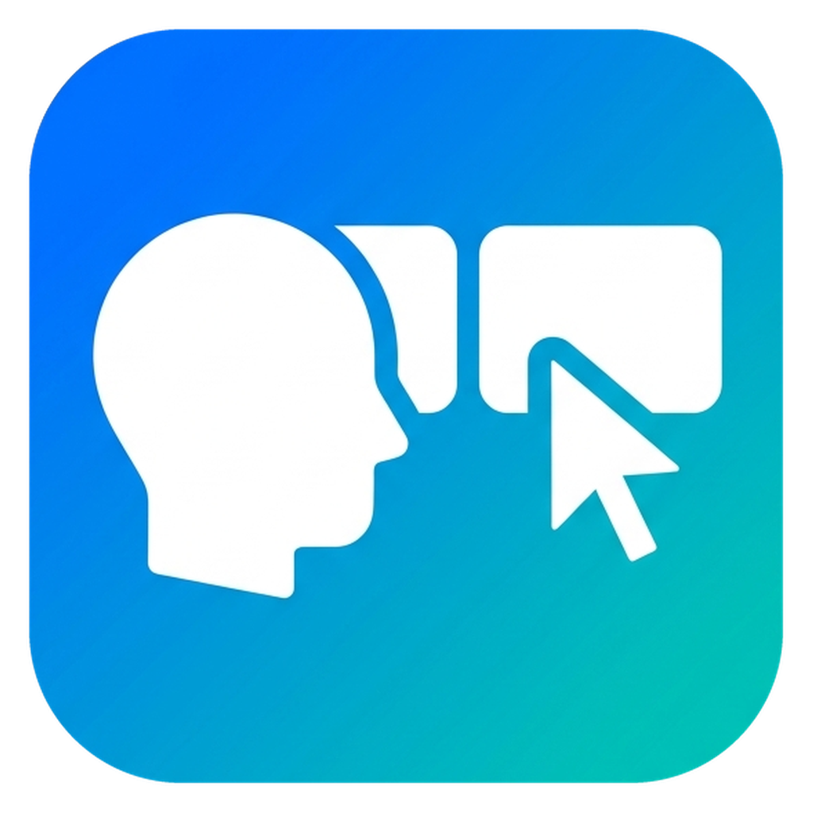

<p align="center">
  
</p>

<h1 align="center">HeadFocus</h1>

<p align="center"><b>Look at a monitor and your mouse jumps there, ready to type.</b></p>

HeadFocus uses your webcam to see which screen you're looking at, from your head turn
and your eye direction. When you look at another monitor, it moves the mouse to that
screen (back to where you left it) and focuses the window there. No more hunting for
the cursor across two screens.

- Works with 2 or more monitors on Windows 10 / 11
- Runs **100% offline**. Camera images never leave your PC and nothing is saved.
- Low CPU use (it only checks the camera 15 times a second)

## Requirements

- Windows 10 or 11 (64-bit)
- A webcam (a built-in laptop camera works)
- Nothing else. No Python or admin rights needed.

## Install

1. Go to **[Releases](../../releases/latest)** and download **`HeadFocus-Setup-1.0.0.exe`** (about 81 MB).
2. Run it and click **Next** through the steps. You can tick **desktop shortcut** or
   **start when I sign in** if you want them.
   - If Windows shows **"Windows protected your PC"**, click **More info → Run anyway**.
     This appears for any new app that hasn't paid for a signing certificate.

Don't want to install anything? Download **`HeadFocus-1.0.0-portable-win64.zip`** instead,
extract it, and run `HeadFocus.exe` from the folder.

## Use

1. Open **Start Menu → HeadFocus**.
   - The very first launch can take up to a minute while your antivirus checks it.
     After that it starts in seconds.
2. **First time only:** it asks you to calibrate. For each monitor, the mouse jumps to
   its center. Press **Enter**, then look at the mouse for about 5 seconds.
3. Done. Look at a monitor and the mouse follows.

| Key | Action |
|---|---|
| **F9** | Pause / resume (works from any app) |
| **Ctrl+C** in the HeadFocus window | Quit |

The Start Menu also has:
- **HeadFocus - Calibrate**: use it after moving your camera, your chair, or your monitors.
- **HeadFocus - Preview (camera window)**: shows what the camera sees, with live gaze values.

## Uninstall

**Settings → Apps → Installed apps → HeadFocus → ⋯ → Uninstall**, or
**Start Menu → HeadFocus → Uninstall HeadFocus**.

This removes the program, its shortcuts, and your calibration. Nothing is left behind.
For the portable zip, delete the folder and `%APPDATA%\HeadFocus`.

## Tips

- **Light your face.** Eye tracking needs to see your eyes. A dark room or a bright
  window behind you makes it unreliable.
- It waits until you've looked at a screen for a quarter of a second, so quick glances don't move the mouse.
- It never pulls the mouse away while you're holding a mouse button.

## Troubleshooting

| Problem | Fix |
|---|---|
| "No camera found" | HeadFocus needs a webcam. Plug in a USB webcam, or close apps using the camera (Zoom, Teams, Discord) |
| "The camera opened but isn't sending any picture" | Turn on **Settings → Privacy & security → Camera** → "Let desktop apps access your camera", and open any privacy shutter |
| "Couldn't see your face" | Open the camera privacy shutter, add light, and sit facing the camera |
| Your antivirus flags HeadFocus | This is a known false alarm for apps packaged with PyInstaller. Allow it, or [run from source](#run-from-source). All the code is in this repo |
| It switches to the wrong screen | Run **HeadFocus - Calibrate** and look clearly at each screen |

## Privacy

Everything runs locally on your PC. Camera frames are analysed in memory and thrown
away. Nothing is recorded, saved, or sent anywhere, and the app needs no internet.
The only thing stored is your calibration (a few numbers) in `%APPDATA%\HeadFocus\config.json`.

---

## For developers

### Run from source

Needs [Python 3.10+](https://www.python.org/downloads/) with "Add python.exe to PATH" ticked.

1. Click the green **Code** button → **Download ZIP**, then unzip it (or `git clone`).
2. Double-click **`setup.bat`**. It creates a private environment in `.venv` (about 350 MB,
   internet needed once).
3. Double-click **`run.bat`** (`run.bat --preview` shows the camera window), or `calibrate.bat` to recalibrate.

### Adjusting sensitivity

Change the values at the top of `headfocus.py`:

| Setting | Default | What it does |
|---|---|---|
| `EYE_GAIN` | `1.0` | How much your eyes count. Raise it (e.g. `2`) if eye glances don't switch. Lower it (e.g. `0.5`) if it switches too easily. `0` means head only. |
| `DWELL_SECONDS` | `0.25` | How long you must look before it switches |
| `HYSTERESIS` | `0.2` | Raise it if it flickers between screens |
| `CAMERA_INDEX` | `0` | Set to `1` if you have more than one camera and it picks the wrong one |

### Build the installer

1. Install [Inno Setup 6](https://jrsoftware.org/isdl.php) (`winget install JRSoftware.InnoSetup`).
2. Run **`installer\build.bat`**.
3. The files appear in `release\`: `HeadFocus-Setup-<version>.exe` and
   `HeadFocus-<version>-portable-win64.zip`. Upload both to a GitHub Release.

To release a new version, change `VERSION` in `installer\build.bat` and the numbers in
`installer\version_info.txt`.

### Project layout

```
headfocus.py            the whole app
setup.bat / run.bat / calibrate.bat   run from source
requirements.txt        Python packages
assets/
  logo.png              1024px logo (transparent)
  icon.ico              Windows icon, 16-256px
installer/
  build.bat             builds the exe, portable zip and installer
  HeadFocus.iss         Inno Setup installer script
  version_info.txt      exe version details (Properties > Details)
  collect_licenses.py   bundles third-party license texts
  make_icon.py          makes assets/ from a logo image: python installer\make_icon.py image.png
  README.txt            short guide installed next to the exe
```

## License

[MIT](LICENSE). Free to use, modify, and share. Third-party components are listed in
[THIRD_PARTY_NOTICES.md](THIRD_PARTY_NOTICES.md).
